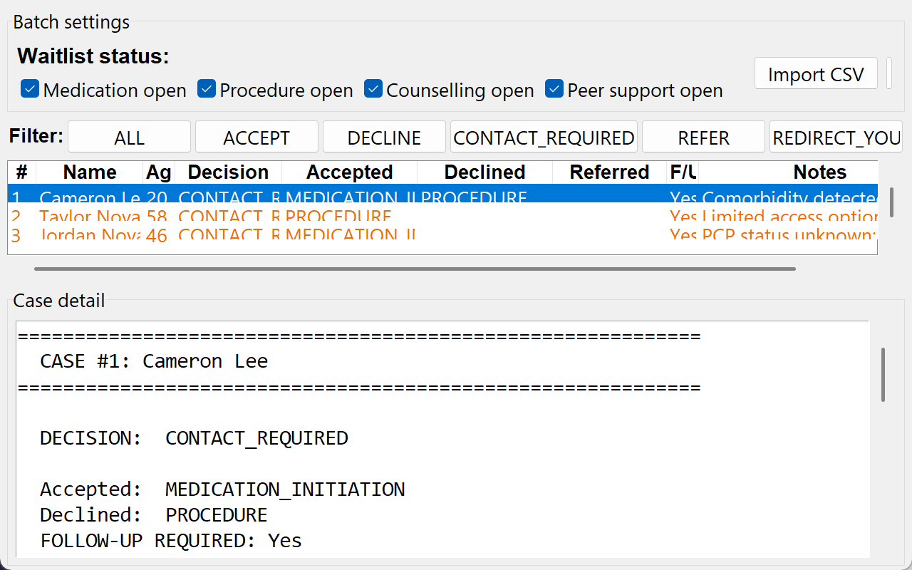
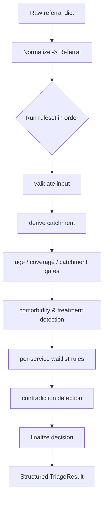

# triagekit

**A configurable, deterministic, and fully auditable engine for clinical referral triage.**

[](https://github.com/ZvanAllen/triagekit/actions/workflows/ci.yml)
[](https://www.python.org/)
[](LICENSE)

`triagekit` turns a program's referral-triage policy into an ordered set of small,
individually-testable rules that run over normalized referral records and emit a
structured decision. **No model sits in the decision path** — every output traces
to the exact rule and field that produced it. The bundled reference implementation
triages referrals for a fictional weight-management program; the engine core is
domain-agnostic.

> **Status:** research prototype. All data in this repository is **synthetic** —
> no real patient information is used anywhere. See [Provenance & ethics](#provenance--ethics).

---

## Why this exists (the short version)

This started as an *AI-first* project: a frontier LLM could triage these referrals
well from a structured prompt. But the deployment setting — a community health
program handling sensitive data — could not send records to a hosted model, and
local hardware couldn't run one that was capable enough. The requirement that
survived every constraint was **auditability**: a triage coordinator has to be
able to see *why* a referral was routed the way it was.

So the decision logic became a deterministic rules engine, and the LLM moved out
of the decision path. `triagekit` is that engine. (An optional
[LLM baseline](#optional-llm-baseline) is included so the two approaches can be
compared later — but the LLM is a *baseline*, not the product.)

---

## What's in the box

```
src/triagekit/
├── engine.py           # generic rule-runner: record + ordered ruleset -> result
├── models.py           # Referral (normalized input) and TriageResult (output)
├── config.py           # TriageConfig loaded from YAML (catchment, keywords, ages)
├── detectors.py        # transparent keyword detectors (comorbidity, treatment)
├── normalize.py        # bool/int coercion for messy EMR/CSV values
├── rulesets/
│   ├── clinic.py       # the reference clinical policy (17 named rules)
│   └── demo.py         # a tiny non-clinical policy proving the core is generic
├── cli.py              # `triagekit run` — batch-triage a CSV
├── app.py              # `triagekit-app` — desktop review tool (tkinter)
├── baselines/llm.py    # optional Claude baseline (not in the decision path)
└── configs/clinic.yaml # the program-specific configuration as data
```

The engine itself knows nothing clinical. A **config** (YAML) supplies the
catchment postal patterns, keyword lexicons, and age thresholds; a **ruleset**
supplies the ordered policy. Swap both and the same engine triages something else
— which the [demo ruleset](#reusing-the-engine) demonstrates.

---

## Install

```bash
git clone https://github.com/ZvanAllen/triagekit.git
cd triagekit
pip install -e ".[dev]"          # add ",llm" for the optional Claude baseline
```

Requires Python ≥ 3.10. The only runtime dependency is PyYAML.

## Quickstart

**Command line** — triage a CSV batch:

```bash
triagekit run data/synthetic/referrals.csv -o results.json
```

**Python API:**

```python
from triagekit import build_clinic_engine

engine = build_clinic_engine()                   # uses the bundled reference config
result = engine.run({
    "first_name": "Sam", "last_name": "Rivers", "age": 30,
    "postal_fsa": "Z1C", "connected_pcp": True,
    "request.counselling": True, "waitlist.counselling_open": True,
})
print(result.decision)            # "ACCEPT"
print(result.accepted_services)   # ["COUNSELLING"]
print(result.to_dict())           # full structured output
```

Every referral resolves to one of five decision states — `ACCEPT`, `DECLINE`,
`CONTACT_REQUIRED`, `REFER`, `REDIRECT_YOUTH` — plus the accepted / declined /
referred service lists, any detected contradictions, and human-readable notes.

---

## Desktop review tool

A coordinator-facing GUI wraps the same engine: import a batch, set the batch
waitlist state, run, then review, filter, sort, and override individual
decisions before exporting (CSV / Excel / printable summary).



```bash
pip install -e ".[app]"     # tkinter ships with Python; this adds openpyxl for Excel export
triagekit-app               # or: python -m triagekit.app  →  File ▸ Load sample data
```

The triage logic lives in `triage_referrals()` (no GUI dependency), so it's unit-
tested headlessly; the window is a thin shell over it.

---

## How the engine works

A `TriageEngine` runs an ordered list of **rules**. Each rule reads the record,
optionally mutates the shared result, and either stops evaluation or falls through
to the next rule.



A rule is just a function `(record, result, config, context) -> STOP | CONTINUE`.
That makes each policy step independently readable and unit-testable — see
[`tests/test_clinic_rules.py`](tests/test_clinic_rules.py), where every rule is
isolated by a single-field change to a known-good base referral.

The full policy is documented in
[`docs/decision-logic.md`](docs/decision-logic.md).

---

## Reusing the engine

The core is not tied to clinical triage. The included `demo` ruleset triages
generic support tickets with the same engine:

```python
from triagekit import TriageConfig, TriageEngine
from triagekit.rulesets.demo import DEMO_RULES, TicketRecord

engine = TriageEngine(TriageConfig(), DEMO_RULES, record_factory=TicketRecord.from_raw)
engine.run({"subject": "server down", "urgent": True, "has_contact": True}).decision
# -> "ACCEPT"
```

To retarget the clinical engine to another program, edit `configs/*.yaml`
(catchment, keywords, ages, exempt procedure types, destinations) and write a
ruleset that orders your policy — no engine changes required.

---

## Optional: LLM baseline

For comparison, `triagekit.baselines` can triage the same referral with Claude,
returning the identical output schema:

```python
from triagekit.baselines import triage_with_llm   # needs: pip install "triagekit[llm]"
triage_with_llm(referral)   # -> {"decision": "...", ...}; cached to .llm_cache/
```

This calls the Claude API (`ANTHROPIC_API_KEY` or an `ant auth login` profile) and
is provided purely as a research baseline. A formal head-to-head comparison
(agreement, cost, latency, consistency) against the deterministic engine is
future work — see below.

---

## Evaluation

This engine was built for a referral program that ended before a formal
evaluation. In pre-production validation on 40 mock referrals, it reached
**95% adjusted agreement** with a triage coordinator's decisions. That comparison
also surfaced inconsistencies in the reference labels themselves, and the project
ended before they were finalized, so treat the figure as preliminary. The mock
referrals and the scoring harness are not included in this repository.

What *is* verified here: the reference ruleset is a behavior-preserving refactor
of an earlier monolithic engine (checked case by case), and the rule logic is
covered by the test suite.

---

## Development

```bash
pip install -e ".[dev]"
pytest            # run the suite
ruff check .      # lint
```

## Provenance & ethics

- **No real patient data.** Every CSV and example in this repo is synthetic,
  generated by [`data/synthetic/generate.py`](data/synthetic/generate.py). Names,
  postal codes, medications, and destination labels are fictional placeholders.
- The reference ruleset keeps the structure of a clinician-reviewed triage
  policy, recast as a fictional weight-management program. Its lexicons, age
  thresholds, postal patterns and destinations are illustrative, not any real
  clinic's values.
- This is a component of a health-services research project on referral-triage
  automation. The policy encoded here is a research artifact, not clinical advice,
  and is not a substitute for a trained triage coordinator.
- The engine is intended to *assist* a coordinator by preparing structured
  decisions for review — especially the `CONTACT_REQUIRED` cases — not to make
  final decisions autonomously.

## License

MIT — see [LICENSE](LICENSE).
